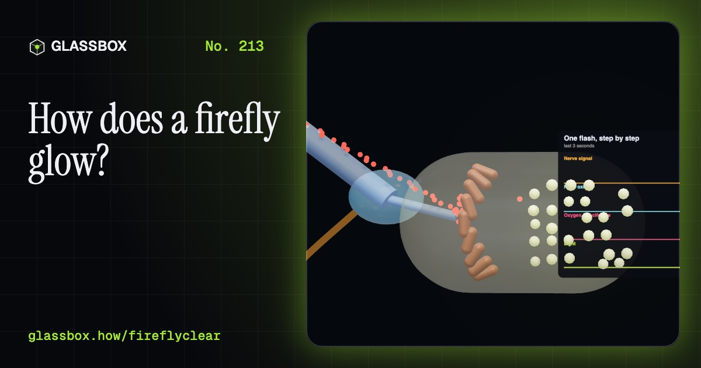
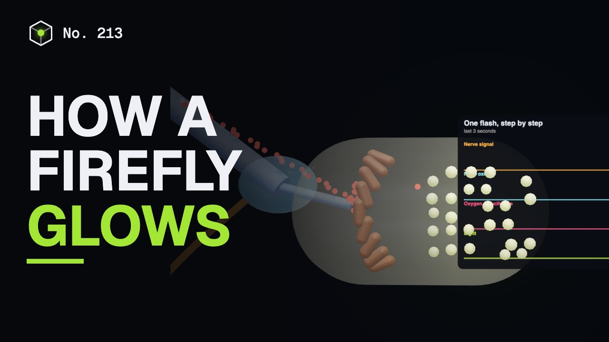
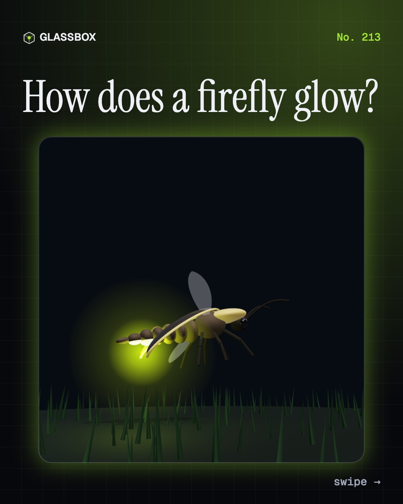
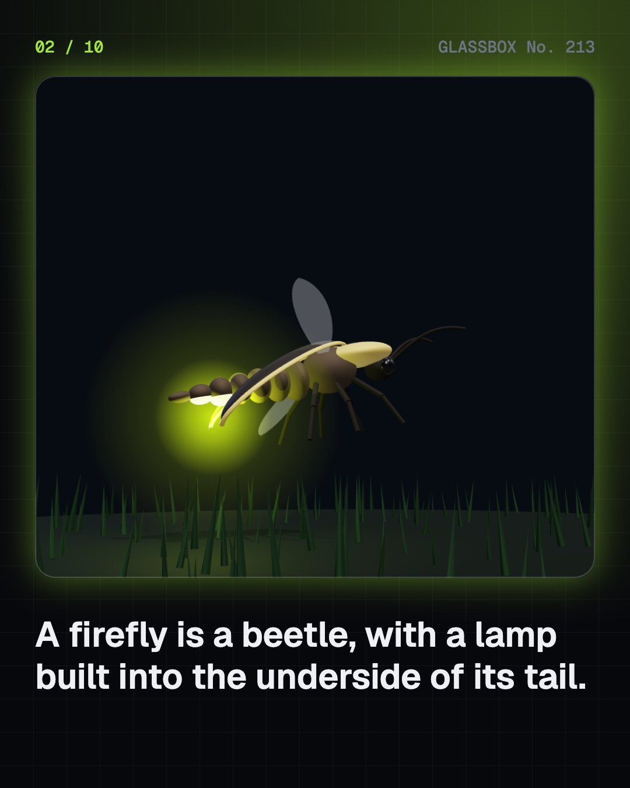
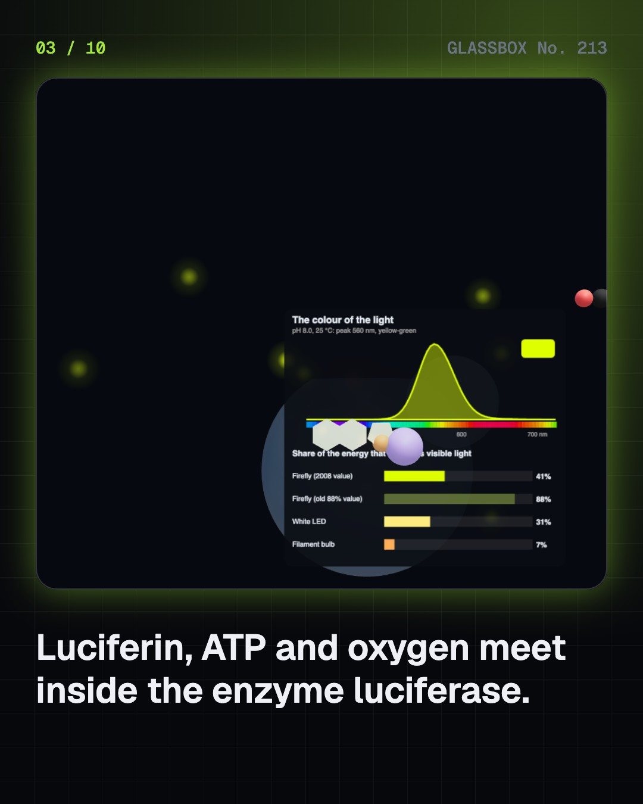
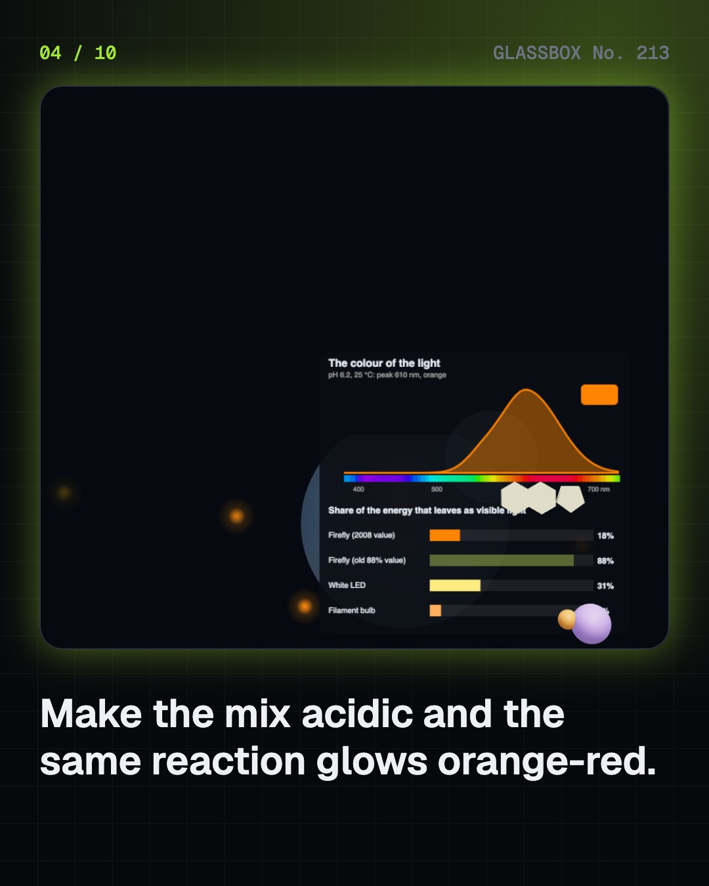

<!-- glassbox:start -->
<!-- Generated from glassbox.json by the Glassbox hub (npm run readme -- fireflyclear). Edit glassbox.json, not this block. -->
<p align="center"><a href="https://glassbox.how/e/fireflyclear/"></a></p>

<h1 align="center">FireflyClear</h1>

<p align="center"><b>How does a firefly glow?</b><br>A firefly is a beetle with a lamp in its tail that wastes almost nothing as heat. Watch one enzyme turn luciferin, ATP and oxygen into a single yellow-green photon, flip the oxygen switch with a puff of nitric oxide, and make a whole tree of fireflies fall into step.</p>

<p align="center"><a href="https://glassbox.how/fireflyclear/"><b>▶ Play with it</b></a> &nbsp;·&nbsp; <a href="https://glassbox.how/e/fireflyclear/">Read the 60-second explainer</a> &nbsp;·&nbsp; <a href="https://glassbox.how/fireflyclear/glassbox/reel.mp4">Watch the 40-second video</a></p>

<p align="center">
  <a href="https://glassbox.how/e/fireflyclear/"></a>
  <a href="https://glassbox.how/e/fireflyclear/"></a>
  <a href="LICENSE"></a>
  <a href="LICENSE-CONTENT.md"></a>
  <a href="#privacy"></a>
</p>

## In 60 seconds

1. **A beetle with a lamp.** A firefly is a beetle. Its lantern, under the last belly segments, is packed with light cells arranged round air tubes, backed by a white reflector of uric-acid crystals. Nerves run in, but end on the air-tube cells rather than the light cells.
2. **Light from chemistry, not heat.** Inside each light cell the enzyme luciferase uses ATP to prime luciferin, then oxygen. A strained ring snaps, leaving oxyluciferin with just enough energy for one yellow-green photon near 560 nm. A careful 2008 measurement found 41 photons per 100 reactions (not the 88 long quoted), still far ahead of a filament bulb's 7% and a little ahead of a good white LED's 30% or so.
3. **An oxygen switch.** The lantern is dark because mitochondria near the air tubes use up the oxygen. In the leading model, a nerve signal makes the air-tube cells release nitric oxide, which briefly blocks the mitochondria. Oxygen floods through and the cell flashes. In extra oxygen, the lantern glows nonstop.
4. **Codes, liars and synchrony.** Each species has a flash code: a common eastern firefly male flashes a J every 6 seconds and his female answers 2 seconds later. Photuris females fake other species' answers to eat the males. Some fireflies flash in step, which a coupled-oscillator model reproduces.
5. **Fireflies of India and the world.** India has at least 92 species, about 60% found nowhere else, most in the Western Ghats. Pre-monsoon festivals at Bhandardara and Purushwadi draw crowds whose torches and footsteps harm the displays. Worldwide, experts rank habitat loss, light at night and pesticides as the top threats.
6. **How we found out.** Boyle saw glowing wood go dark in his air pump in 1667. Dubois split the glow into luciferin and luciferase in the 1880s. McElroy found the need for ATP in 1947. The luciferase gene was copied in 1985 and made a tobacco plant glow in 1986. Firefly luciferase now checks hospital surfaces and lights up genes in labs.

## Words worth knowing

| Term | Meaning |
|---|---|
| **Bioluminescence** | Light made by a living thing through a chemical reaction. |
| **Luciferin** | The fuel molecule that is oxidised to make the light. |
| **Luciferase** | The enzyme that brings luciferin, ATP and oxygen together to make light. |
| **Photocyte** | A light-making cell in the firefly's lantern. |
| **Quantum yield** | How many photons are made per 100 molecules that react; about 41 for fireflies. |
| **Oxygen gating** | Switching the lantern by controlling how much oxygen reaches the light cells. |
| **Nitric oxide** | A small gas molecule that, in the leading model, briefly blocks mitochondria to let oxygen through for a flash. |
| **Aggressive mimicry** | A predator faking another animal's signal to lure prey, as Photuris femmes fatales do. |
| **Coupled oscillators** | Rhythms that nudge one another until they keep time together. |

## A short history

**350 years from glowing wood in an air pump to a gene that lights up labs, and a race to keep the real fireflies flashing.**

- **1667** · Glowing wood goes dark without air (Robert Boyle, Oxford, England)
- **1885** · Two parts to the glow (Raphaël Dubois, France)
- **1887** · Luciferin and luciferase named (Raphaël Dubois, France)
- **1947** · ATP lights up a spent extract (William D. McElroy, Johns Hopkins University, Baltimore)
- **1965** · Femmes fatales (James E. Lloyd, Gainesville, Florida)
- **1968** · How whole trees flash in time (John and Elisabeth Buck, Thailand and USA)
- **1985** · The luciferase gene is copied (Jeffrey de Wet, Keith Wood, Donald Helinski and Marlene DeLuca, University of California, San Diego)
- **1986** · A tobacco plant that glows (David Ow, Keith Wood, Marlene DeLuca and colleagues, University of California, San Diego)

The full story, with 25 moments, charts, people and 31 sources: [glassbox.how/e/fireflyclear/history](https://glassbox.how/e/fireflyclear/history/). The data lives in [`history.json`](history.json).

## Video and slides

Made with the Glassbox studio from this box's storyboard (`window.glassbox.director`). Free to reuse under CC BY 4.0.

<a href="https://glassbox.how/fireflyclear/glassbox/video.mp4"></a>

<p><a href="glassbox/slide-1.jpg"></a> <a href="glassbox/slide-2.jpg"></a> <a href="glassbox/slide-3.jpg"></a> <a href="glassbox/slide-4.jpg"></a></p>

| File | What | Size |
|---|---|---|
| [`glassbox/reel.mp4`](https://glassbox.how/fireflyclear/glassbox/reel.mp4) | Reel / Short, with captions and soundtrack | 1080×1920 |
| [`glassbox/video.mp4`](https://glassbox.how/fireflyclear/glassbox/video.mp4) | YouTube video, with captions and soundtrack | 1920×1080 |
| `glassbox/slide-1…10.jpg` | Instagram carousel | 1080×1350 |
| `glassbox/thumb.jpg` | YouTube thumbnail | 1280×720 |
| `glassbox/cover.jpg` | Share card and repo social preview | 1200×630 |
| [`glassbox/history-reel.mp4`](https://glassbox.how/fireflyclear/glassbox/history-reel.mp4) | “History in 10 moments” Reel / Short | 1080×1920 |
| `glassbox/history-slide-*.jpg` | History carousel | 1080×1350 |
| `glassbox/post.json` | Post copy and schedule used by the publish kit | |

## Privacy

This box has no accounts and no ads, and it ships its own fonts and libraries. When you run it yourself it sends nothing anywhere. On glassbox.how, the site's `/bar.js` also loads Glassbox's analytics: **Google Analytics** to count visits (it asks first in the EU, UK and Switzerland, and stays off when your browser sends Global Privacy Control or Do Not Track) and **ClickTrust** to detect bots.

It remembers a few things **in your own browser only**, and never sends them anywhere:

| Browser storage key | What it holds |
|---|---|
| `fireflyclear.v1` | Which chapters you have opened, your best quiz scores, and sound on or off. |

Exactly what each one sees is at [glassbox.how/privacy](https://glassbox.how/privacy/).

## Licences

- **Code:** [MIT](LICENSE). Use it, change it, ship it.
- **Explanations, text, images and videos** (`glassbox.json`, `glassbox/`): [CC BY 4.0](LICENSE-CONTENT.md). Credit “Glassbox, glassbox.how/e/fireflyclear”.
- **Third-party parts** keep their own licences: [three.js](https://threejs.org) (MIT), [Geist, Instrument Serif](https://openfontlicense.org) (SIL OFL 1.1).
- The Glassbox name and logo aren't covered by either licence. See the [terms](https://glassbox.how/terms/).

Found a mistake? [Open an issue](https://github.com/bdeeps/fireflyclear/issues). Corrections happen in public.
<!-- glassbox:end -->

## Run it

It's plain HTML, CSS and JavaScript. No build step and no dependencies. Run locally, it contacts no other website.

```bash
python3 -m http.server 8000
```

Three.js and the fonts ship in `vendor/` and `fonts/`, so it also works offline.

Then open http://localhost:8000.

## How it's built

| File | What |
|---|---|
| `index.html`, `css/app.css` | The page and its styles |
| `js/app.js`, `js/stage.js`, `js/ui.js`, `js/kit.js` | The shared Glassbox 3D engine: chapters, 3D stage, controls, quiz, video director |
| `js/fly.js` | FireflyClear's shared parts: the light model (spectrum, colour, quantum yield, energy share against lamps), the flash-switch and synchrony models, a procedural firefly and the chart boards |
| `js/chapters/*.js` | One file per chapter: the 3D model, controls, text, key terms, quiz and video scenes |
| `glassbox.json` | Title, question, explainer beats, key terms, browser storage and credits shown on glassbox.how |
| `reel` in each chapter | The storyboard the Glassbox studio records into short videos |
| `glassbox/` | The published video, slides, thumbnail and post copy |
| `fonts/`, `vendor/three/` | Self-hosted Geist and Instrument Serif (SIL OFL 1.1) and three.js (MIT) |
